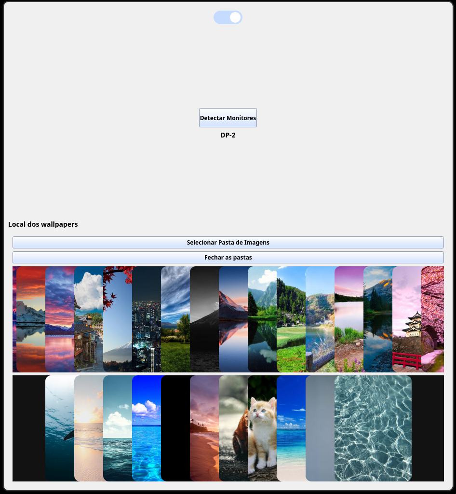
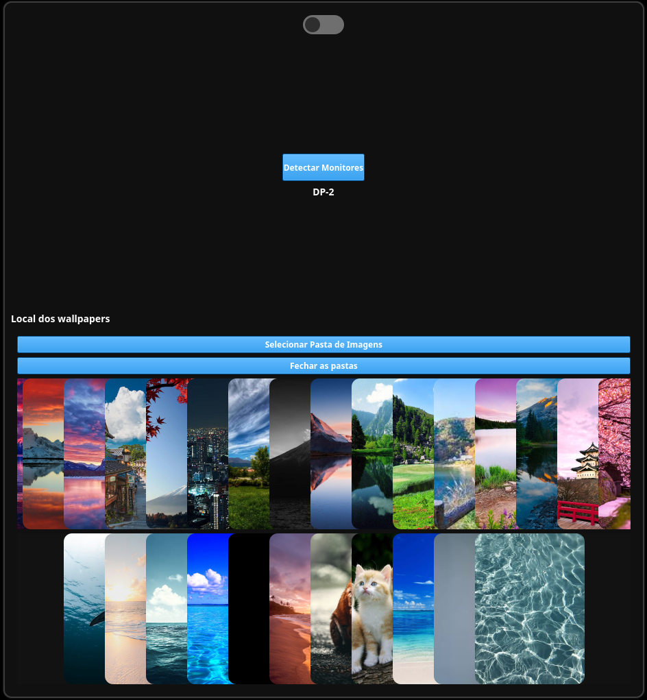

# HyprpaperEngine


Seletor de wallpaper para o hyprpaper  
Ainda em desenvolvimento, mas grande parte funciona sem problema  

Utilizado Python e Shell Script  
O projeto tambem usa o Pyside6 do Qt framework  

As configuracoes sao salvas no .json  
Por padrao sera aberto no tema escuro  

## Funcionalidades

* 🔄 Alterna wallpapers instantaneamente sem reiniciar o Hyprpaper.
* 📂 Suporte para carregar imagens de uma pasta específica (`~/Pictures/Wallpapers`).
* ⚙️ Atualiza o arquivo de configuração automaticamente.

## Pré-requisitos

Antes de usar, garanta que você tem instalado:

* [Hyprland](https://hyprland.org/)
* [Hyprpaper](https://github.com/hyprwm/hyprpaper)

Para quem quiser desenvolver o projeto será preciso o Qt instalado

* [Qt](https://doc.qt.io/qt-6/linux-alternative-installers.html)

## Instalação

1. Baixe o executavel nas realeses 
    * [Realeses](https://github.com/DHT-xt/HyprpaperEngine/releases)

2. Execute o arquivo "HyprpaperEngine", mas se a caso nao abra use na pasta que salvou o executavel:
    ```bash
    chmod +x HyprpaperEngine


Ou caso preferir clonar o repositório

1. Clone este repositório:
   ```bash
   git clone [https://github.com/DHT-xt/HyprpaperEngine](https://github.com/DHT-xt/HyprpaperEngine.git)
   cd HyprpaperEngine

para executar

2. Execute com o python o arquivo main:
    ```bash
    python main.py


Ao executar deve aparecer um janela conforme o seguinte

<table border="0">
  <tr>
    <td>
      <p align="center"><b>Modo Claro</b></p>
      
    </td>
    <td>
      <p align="center"><b>Modo Escuro</b></p>
      
    </td>
  </tr>
</table>

Obs: Os cards de preview dos wallpapers serao gerados ao selecionar a pasta

## Utilizar

Apos executar e a janela aparecer, sera preciso:

* Informar qual monitor utilizar pela opcao de selecao de monitores

* Informar a pasta de imagens que deseja utilizar para a selecao de Wallpapers

IMPORTANTE:

 * O arquivo de configuracao json fica salvo em /home/{SeuUsuario}/config/config.json

 * Caso ja tenha um .conf do hyprpaper, eh feito o backup em /home/{SeuUsuario}/HyprpaperEngine/backup/

 * Suporta mais de uma pasta selecionada, porem mais de duas pastas podem causar problema na exibicao no layout (Esperado corrigir em breve)

Para selecionar o wallpaper, basta apenas clicar em cima da preview do mesmo

## Adicional

Atualmente eh uma versao alpha (Mais para prototipo)  
Bugs sao esperados

Enfim ;)
